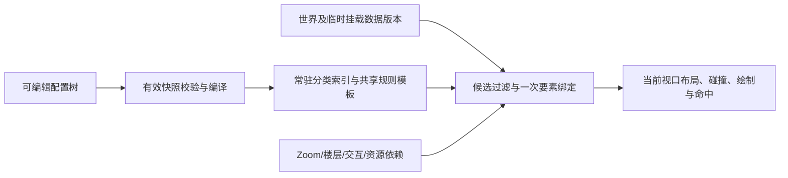

# V3.2 前端入口、渲染性能与配置编辑整合实施蓝图

日期：2026-10-09。状态：**已获用户授权并实施；自动核验通过，等待用户人工验收。** 原要求保留为实施参照，最终结果见同目录 `RuntimeV32_Frontend_Runtime_Editor_Implementation_Report_2026-10-09.md`。

本文件是本轮后续实施的统一参照，合并前端六项反馈、常驻编译与多条件规则讨论、非分类字段限制、新分类预填及临时挂载兼容要求。此前讨论蓝图保留为历史依据；后续以本文件和配套计划清单为准。

配套：[实施计划清单](G:/RIAWebGIS/NewPRES/CairnMap_Codex/wt/cairnmap-config-runtime-v32-migration-20261007/docs/90_roadmap-and-history/RuntimeV32_Frontend_Runtime_Editor_Implementation_Plan_2026-10-09.json)。该 JSON 是实施任务清单，**不是可导入的配置包**。

## 1. 基线、目标和授权边界

| 项目 | 基线 |
| --- | --- |
| 当前工作树 | `G:/RIAWebGIS/NewPRES/CairnMap_Codex/wt/cairnmap-config-runtime-v32-migration-20261007` |
| 分支 | `codex/cm-config-runtime-v32-migration-20261007` |
| 整理前 HEAD | `bf6748d9487fffe6d53709e865185df22be1b34d`；工作树干净 |
| 功能源码基线 | `b7b6e414538f3baee48ab3b3975988e90aa5363e`；其后的两个提交仅为蓝图文档 |
| 独立 V1 参照 | `G:/RIAWebGIS/NewPRES/CairnMap_Codex/wt/cairnmap-v1-parity-reference-20261008`，冻结提交 `0b82863d4fea3791f98917ba6d13f70e1f27eb15` |
| 当前交付配置 | V3.2，包 revision 2，contractRevision 6；下一新模型建议 contractRevision 7，包 revision 单独递增 |

本次目标：让实际实验室的测绘/测量入口可用，消除 V3 重复解析与无效全图刷新；完成统一扩展编辑、明确密度顺序、模块帮助、多条件规则及两种模板创建能力，同时保持 V1 显示、交互和工作流最终输出的既有等价要求。

继续仅本地更新，每个功能主题形成独立可回退提交。用户随后明确授权了本蓝图的功能生成；未授权远程 push、PR、main 或 RIA 同步。原 V32 工作树保持原状，不 reset、不覆盖。功能、验收和交付结果以实施报告及本轮证据为准。

依据：[前端问题排查报告](G:/RIAWebGIS/NewPRES/CairnMap_Codex/migration-audits/runtime-v32-feedback-20261009/Frontend_Feedback_Findings_2026-10-09.md)、[既有交付报告](G:/RIAWebGIS/NewPRES/CairnMap_Codex/wt/cairnmap-config-runtime-v32-migration-20261007/docs/90_roadmap-and-history/RuntimeV32_V1Parity_Implementation_Report_2026-10-09.md)、当前代码及本轮用户确认。已有测试结果属于基线证据，不能直接记为新版本通过。

## 2. 全部需求与交付范围

| 编号 | 必须完成的事项 | 实施结果 |
| --- | --- | --- |
| R01 | 实验室测绘、测量无法首次启用 | 所有工作区共用模块启用弹窗、加载与失败反馈，启用后打开原来请求的工具 |
| R02 | 三个高级模块收进统一扩展区域 | 每条规则只有一个“扩展规则”折叠入口，保留常用设置及正确数据归属 |
| R03 | 密度降低顺序同时体现在 UI 和执行中 | 选择编号、实际有序列表、grip 排序及运行时按相同数组执行 |
| R04 | 统一菱形问号帮助 | 指定模块、Label 独立碰撞指标及所有扩展子模块有具体说明，鼠标/键盘/触屏均可访问 |
| R05 | 重复解析、全图刷新导致卡顿 | 静态规则激活时编译常驻，正确依赖缓存、单次绑定复用、预计算排序与按影响更新 |
| R06 | 单条规则为 Zoom＋组合字段条件 | 必填逻辑 Zoom、选填受控 AND/OR/NOT 条件，完整规则匹配语义明确 |
| R07 | 条件只能使用非分类字段 | 分类字段、别名及映射在编辑、导入、保存与编译中均被排除 |
| R08 | 新增单条规则复制完整内容 | 内容完整预填，源匹配条件不复制，目标条件保持独立，不二分原规则 |
| R09 | 新增分类继承或复制显示规则组 | 默认继承父级；任何兼容分类可预填，平级优先，整组保留条件及顺序 |
| R10 | 兼容现有临时挂载 | 新增/启停/覆盖/删除/恢复/修改/世界切换同步更新显示、交互及相关索引 |

“有效扩展值与来源”继续作为现有静态继承/覆盖检查能力，不新增全运行链追踪功能。本轮会为其补帮助，说明其当前范围。旧“字段条件分支”按后续明确要求迁入 R06，不再保留为新 r7 的第二套分支编辑入口。

## 3. 实验室的模块入口修复（R01）

### 3.1 问题与修改位置

已定位：[App.tsx](G:/RIAWebGIS/NewPRES/CairnMap_Codex/wt/cairnmap-config-runtime-v32-migration-20261007/src/App.tsx) 在 Config Lab/Studio 分支提前返回，公共 `FeatureModuleLoadDialog` 与 `FeatureModuleLoadingOverlay` 仅存在普通首页。实际实验室点击后 store.dialog 已打开，页面却没有启用弹窗。测绘和测量共用 measuring 模块，因此冷启动均受影响；已启用缓存可能掩盖问题。

改为先选取工作区内容，再统一挂载一次公共模块弹窗和加载反馈。保留 [featureModuleStore.ts](G:/RIAWebGIS/NewPRES/CairnMap_Codex/wt/cairnmap-config-runtime-v32-migration-20261007/src/store/featureModuleStore.ts) 的按需加载、启用持久化、重复请求合并及版本检查。首轮不因修复而提前加载整套测绘代码。

### 3.2 需要得到的行为

- 初次点击测绘/测量：看得到启用弹窗，确认后有加载反馈，完成后打开请求的那个工具；两个入口的待打开意图正确。
- 取消：不打开工具，不留下遮罩或之后意外打开的旧请求；再次点击仍可正常启用。
- 已启用：直接走原自动加载流程，不重复出现首次启用提示。
- 加载失败：显示原因并允许重试；成功后恢复操作，不长期卡在 loading。
- 首页、Lab V1、Lab V3 和兼容工作区均保持单一公共弹窗实例；桌面和窄屏不被地图或侧栏遮挡。

验收从真实 `App → ConfigLab → 工具入口` 开始。直接挂载 MeasuringModule 的旧测试只能作为底层补充，不能替代冷缓存全应用入口验收。随后通过该入口实际创建、提交和临时挂载 V3 工作流输出。

## 4. 常驻编译与渲染刷新修复（R05）

### 4.1 已确认的瓶颈及原则

本机开发环境、同世界/相机和 463 条记录、六次无动画缩放的排查证据：V1 ScriptDuration 约 0.110s，V3 约 2.873s，V3 有 386–590ms 长任务。热点为分类继承扫描、扩展合成/structuredClone、排序和渲染重复解析。默认 hover 关闭仍改变 hoveredUid，引发整轮渲染。该测量是诊断基线，后续须用相同条件重测。

V1 也是树状配置，但已有模块级规则数组和关系缓存；问题不在树状编辑格式本身。V3 保留完整可编辑树，在有效配置加载/激活时生成原生索引与规则模板。编译只规范化数据、绑定既有受控算法，不使用 eval/Function，不依赖旧 component executor 或 V3.1 界面。



### 4.2 四层数据及失效边界

| 层 | 常驻/缓存内容 | 更新条件 |
| --- | --- | --- |
| 配置编译 | 分类路径、祖先链、有效字段/显示/信息卡继承、静态默认、规则模板、9 个 Zoom 候选桶、安全读取器、上下文定义及依赖描述 | 新有效配置快照激活或有效编辑预览快照改变 |
| 世界数据 | 原始/挂载合并结果、分类与 ID/关联索引、包围盒、面积/长度/部件数及字段/几何版本 | 加载、字段/几何修改、临时源及覆盖/删除变化、世界切换 |
| 要素绑定 | 命中规则、文本/颜色/关联值、A/B/C 指标及需要的交互参数 | 其声明依赖的数据、关系、Zoom、楼层、选择状态或资源改变 |
| 屏幕布局 | 投影锚点、每部件候选、文字/图标尺寸、碰撞密度与命中区域 | 相机、布局相关参数、文本/几何/字体/图片或相关状态改变 |

缓存标识采用配置对象身份/运行时 epoch 或激活时内容指纹，不能只用 packageId/revision。同一修订号的不同草稿内容不可共用旧结果。编译结果与编辑对象分离；导出仍是纯数据，不导出函数、缓存或要素绑定结果。无效草稿/导入不得取代有效活动配置。

依赖声明必须覆盖同 ID 换记录、关联对象变化、世界/投影、楼层和字体/图片到达。先采用保守正确失效，再缩小范围；不能为了提速保留过时结果。缓存按实际访问、有界存储并在世界卸载时释放；不预生成“全量记录×9 Zoom×全部交互态”。

### 4.3 一次刷新中的工作

1. 提前利用包围盒/空间索引取当前 padded layoutBounds 的候选，保留跨视口大面、Label/图标越界以及选中/搜索目标；完整数据仍提供给搜索和关联查询。
2. 从分类、几何和 Zoom 候选桶选规则，每个候选只绑定一次必要数据，同次刷新复用给排序、密度、绘制、信息卡和点击。
3. 预计算 A（几何层级）、B（Label 碰撞）、C（显示权重）与稳定排序键；比较器只比较结果，禁止再次遍历配置树、合成扩展或计算几何。
4. 合成默认扩展、交互基线和静态样式在编译时完成；只计算实际状态所需的动态值，不为每条记录重新生成全部状态对象。
5. 未启用 hover 且无其他悬停依赖时，不更新视觉 hoveredUid、不触发全图重排。信息卡选择与视觉状态分别处理；启用 hover 时按实际影响更新样式、命中或必要布局。
6. 不以每次交互清空并重建全图作为默认刷新策略。样式变化更新相关图层；影响 Label 优先级/显隐/候选时重排受影响区域，无法证明局部充分时执行保守较大重排。世界/楼层及全局规则变化执行相应整体更新。
7. 保留稳定锚点、密度预算、各部件 Label 和点击一致性；不能通过隐藏原本可见的要素或关闭已承诺能力取得性能数字。

重点修改：[runtime.ts](G:/RIAWebGIS/NewPRES/CairnMap_Codex/wt/cairnmap-config-runtime-v32-migration-20261007/src/configStudio/runtime.ts)、[configPackageAdapter.ts](G:/RIAWebGIS/NewPRES/CairnMap_Codex/wt/cairnmap-config-runtime-v32-migration-20261007/src/components/Rules/configRuntime/configPackageAdapter.ts)、[RuleDrivenLayer.tsx](G:/RIAWebGIS/NewPRES/CairnMap_Codex/wt/cairnmap-config-runtime-v32-migration-20261007/src/components/Rules/core/RuleDrivenLayer.tsx)及既有布局缓存。可新增原生编译/依赖辅助模块，但这些名称不代表当前已有实现。

Worker 不是本轮前置条件。先去掉重复主线程工作；Leaflet DOM 和实际文字测量仍需主线程。

## 5. Zoom＋非分类字段条件的新规则（R06、R07）

### 5.1 编辑及保存模型

每条规则有唯一 ID、一段必填逻辑 Zoom、一组选填字段条件和一份完整渲染内容。建议 r7 结构：

```json
{
  "id": "new-rule",
  "when": {
    "zoom": { "min": 6, "max": 8 },
    "fields": {
      "op": "all",
      "items": [
        { "kind": "fieldEquals", "field": "Level", "value": "主干道" },
        { "kind": "fieldPresent", "field": "Name", "present": true }
      ]
    }
  },
  "representation": "geometry",
  "style": {},
  "label": {},
  "geometryStack": {},
  "priority": {},
  "extensions": {}
}
```

该例只说明结构，不能作为完整合法配置直接导入。匹配为 `所属分类匹配 AND Zoom 匹配 AND 字段组匹配`；不启用字段组时其值为 true。

- Zoom 为闭区间整数 `0 ≤ min ≤ max ≤ 8`，允许 `0–0`、`8–8`；只有这一处匹配 Zoom，字段组不得另放 Zoom/面积/任意代码条件。
- 字段支持现有受控等于、列表包含及存在/不存在；组合支持 all/any/not。默认“全部满足”，启用后的空组阻断保存。首版建议最大深度 4、最多 64 个叶子条件。
- 字段身份按有效字段和存储映射规范化。排除 `Class/Kind/Skind/Skind2`、`SKind/SKind2` 以及映射到分类字段的别名；兼容旧数据若将其他字段作为分类，也按实际分类身份排除。不要用显示名或字符串包含粗略排除普通业务字段。
- 非分类业务字段及合法 tags/extensions 路径可组合；保存值与显示文本分离，继承字段仍可选。比较沿用当前明确语义，覆盖 0、false、空串、缺失/null、数组等边界，不借迁移悄悄更改比较行为。新增数值操作符不自动扩入本轮。
- 字段下拉、模板引用检查、语义校验、JSON/ZIP 导入和编译入口都执行同一限制；嵌套组和手写配置不能绕过。分类条件限制不改变工作流输出分类或信息卡分类显示。
- World 仍为活动世界注入的系统字段，不在每条规则复制设置。逻辑 Zoom、主图和 Lab 的 tile/显示映射保持共享。

### 5.2 重叠规则的选择

本蓝图采用**按编辑列表顺序，最后命中的完整规则生效**的方案，等待本次核验。编译时按倒序候选找首个匹配，保持相同语义。通用规则在前，例外在后；规则选择不由 A/B/C 权重、字段数量或分类名暗中决定。

| 顺序 | Zoom | 字段条件 | 完整结果 |
| --- | --- | --- | --- |
| 1 | 6–8 | 无 | 普通道路 |
| 2 | 6–8 | Level=主干道 | 加宽道路 |
| 3 | 6–8 | Situation=规划 | 规划虚线 |
| 4 | 6–8 | 主干道 AND 规划 | 加宽且虚线 |

同时满足两个例外时，第 4 条明确表达合成效果；没有第 4 条则取第 3 条完整结果，不把各条样式隐式拼接。允许 Zoom 重叠，列表可用 grip 调整顺序，规则头部显示顺序及条件摘要。

非法范围、重复 ID、非法/分类字段、危险路径和可证明矛盾阻断；完全重复条件造成无用规则时阻断。对可证明被后项完全遮蔽的规则提供定位诊断，复杂交叠提示；不承诺穷尽布尔条件可达性。无命中沿用包内显式原生 fallback（隐藏/仅几何），不退回旧执行器。

重点修改：[types.ts](G:/RIAWebGIS/NewPRES/CairnMap_Codex/wt/cairnmap-config-runtime-v32-migration-20261007/src/configStudio/types.ts)、[ConfigStudio.tsx](G:/RIAWebGIS/NewPRES/CairnMap_Codex/wt/cairnmap-config-runtime-v32-migration-20261007/src/configStudio/ConfigStudio.tsx)、runtime、原生适配及包读取/迁移。同步重新生成 [原生契约结构](G:/RIAWebGIS/NewPRES/CairnMap_Codex/wt/cairnmap-config-runtime-v32-migration-20261007/src/configStudio/native-contract-schema.generated.json)，不只修改 TypeScript 而留下过期 schema。

## 6. 两类新增和模板预填（R08、R09）

### 6.1 新增单条渲染规则

独立创建面板提供“空白默认”及“从已有规则复制内容”。不再二分最后一个 Zoom 区间，现有 `8–8` 规则也不妨碍新增。

- 新 ID；新草稿 Zoom 待填，字段条件默认关闭。选择模板后保留目标已填条件。
- 默认列当前分类本地及继承规则；兼容跨分类规则可作为来源，但须校验目标几何能力及字段/资源/关联引用。
- 深复制 representation、几何/图标/颜色、Label 全部设置、A/B/C、全部扩展和继承/覆盖意图；**排除源匹配 Zoom、源字段条件及源编辑身份**。
- 算法内部 Zoom 桶、切换阈值仍是规则内容，不能按属性名含 Zoom 一并清除。源规则不被分割、缩小、覆盖或联动修改。
- 引用失配载入草稿并定位，修正前不能保存/激活；不静默替成 Name/ID。无运行函数、缓存或真实要素值进入副本。

### 6.2 新增要素分类

创建面板先输入分类代码/名称、确定当前父级及目标点/线/面和多部件设置，再选择：

1. **继承当前父级（默认）**：展示祖先链解析后的有效设置，按字段、显示、信息卡各自继承开关生效。未修改保持继承；首次修改显示组时将有效完整组生成本分类本地草稿。父级不被修改。父级关闭某项传播时不得暗中继承；显示状态，可明确选择父级作为兼容模板进行一次性复制。父级未定义几何时先选目标类型；无父级根分类使用系统默认。
2. **选择兼容分类预填**：可选包内任何有效分类的显示规则组，包括其继承有效组。几何类型、`allowMultipleParts` 必须相同；多部件开启时完整中心/各部件中心 `anchor` 也必须相同，缺省按规范化值判断。仍须满足目标祖先几何约束。

候选顺序为**同父级同层级平级分类 → 当前父级（兼容时）→ 其他兼容分类**，组内按完整路径/名称稳定排序，根分类以其他根节点为平级。显示完整路径、名称、几何/多部件/锚点、规则数量并支持搜索。目标几何/多部件改变时重新过滤和检查当前模板，不默默套用失配内容。

这里复制的是**一整组可用规则**：保留每条规则的 Zoom、合法非分类字段条件、顺序和完整内容，生成新 nodeId 及规则 ID。显式继承/覆盖意图保留，全局继承仍引用当前包默认。与“新增单条规则”排除匹配条件的设计严格区分。

新分类路径、名称、父子关系及已确定的几何/多部件/锚点/几何级触发设置属于目标；模板不携带其他分类的字段定义、信息卡、工作流或上下文关系。它们继续按目标父级与现有设置解析。模板后续修改不联动副本。

模板引用的条件字段、文本/图标字段、关联或上下文不一定在目标存在：列出引用诊断并允许修正，未解决前不能保存/激活；不得直接删条件以得到“可保存”副本。取消/放弃不留下半成品节点；未保存草稿继续阻断切换分类/顶级标签。沿用 ConfigStudio 的单一草稿体系。

## 7. 统一扩展规则与帮助（R02、R04）

### 7.1 编辑区域与数据归属

每条规则保留主区的显示效果、Label、基础 zLevel、Label 角色/基础碰撞优先级和基础显示权重；提供**一个默认折叠的“扩展规则”总入口**。

总入口收纳以下三个既有高级模块：

- “显示权重合成与边界”：C 的 add/replace、指标缩放/边界/取整等高级参数。
- “候选、碰撞对象与稳定/密度策略”：候选偏移、碰撞对象、阻挡对象、稳定性/失效、密度策略。
- “本规则交互视觉覆盖”：局部覆盖全局 hover、selected、editing、deletion 等既有视觉设置。

与现有扩展模块合并归属、去重：Pane/zIndex 放入通用层级/文字/点击子模块；每屏 Label 上限和密度参数放入碰撞/密度子模块；候选与稳定性相同字段只保留一个编辑入口。A/B/C 仍是独立模型，移动界面不改变保存路径或默认数值。Label 独立碰撞指标保留在 Label 编辑附近并加帮助，不因 C 收纳而并入显示权重。

相同参数在规则和全局默认编辑中复用控件，并清楚显示继承/本地覆盖。折叠、展开和读取帮助不触发草稿修改。旧 r6 原生兼容编辑若仍保留，也使用统一模块布局；新 r7 不再另建“条件分支高级设置”平行副本。

重点整理：[RenderRuleExtensionsEditor.tsx](G:/RIAWebGIS/NewPRES/CairnMap_Codex/wt/cairnmap-config-runtime-v32-migration-20261007/src/configStudio/RenderRuleExtensionsEditor.tsx)、[DisplayPrioritySettings.tsx](G:/RIAWebGIS/NewPRES/CairnMap_Codex/wt/cairnmap-config-runtime-v32-migration-20261007/src/configStudio/DisplayPrioritySettings.tsx)、[ExtraRuleSettings.tsx](G:/RIAWebGIS/NewPRES/CairnMap_Codex/wt/cairnmap-config-runtime-v32-migration-20261007/src/configStudio/ExtraRuleSettings.tsx)、[InteractionShapeSettings.tsx](G:/RIAWebGIS/NewPRES/CairnMap_Codex/wt/cairnmap-config-runtime-v32-migration-20261007/src/configStudio/InteractionShapeSettings.tsx)及 ConfigStudio 的组合入口。

### 7.2 菱形问号与内容清单

统一在模块标题旁放置**菱形外框、中间问号**的帮助按钮，内容按模块维护，不使用泛化的字段名解释。每条帮助包含：意义、实际效果、编辑/继承方式、单位和简短例子；明确 A/B/C、世界单位与像素、Label 与几何/符号的区别。

| 必须覆盖的标题/模块 | 帮助必须解释的关键内容 |
| --- | --- |
| 显示权重合成与边界 | C 的基础+指标或替代、上下限/取整，不决定哪个规则命中 |
| 候选、碰撞对象与稳定/密度策略及其子项 | 候选偏移正负、检测与阻挡对象区别、锚点复用、失效与有序降级 |
| 本规则交互视觉覆盖 | 局部视觉相对全局基线的覆盖及恢复继承，不新增触发能力 |
| Label 独立碰撞指标 | B 的独立指标与 C 区别，导入 r5 联动兼容选项的效果 |
| 扩展规则总入口 | 默认继承、按规则覆盖及高级设置的使用方式 |
| 通用文字、Pane 与点击 | 文字留白/图层/点击区域及单位，避免把 Pane 当碰撞权重 |
| 跨要素可见性与上下文关系 | 同 ID、重合、线包含、活动上下文的目标引用与显示效果 |
| 面候选点与大面策略 | 面内候选、世界网格/视口候选等何时使用，以及候选数量和性能影响 |
| 面候选权重与切换 | 距中心/边缘等评分、切换阈值和复用加成 |
| 候选锚点与稳定性 | 完整/各部件锚点、候选复用、失效条件及偏移 |
| 完整贴线 / CJK 标签算法 | 贴线/路径/竖排/字形模式、回退、预算、重定位及参数单位 |
| 碰撞、密度与回退 | 碰撞留白/对象、配额、有序动作、保留选中/必显与隐藏/几何回退 |
| 有效扩展值与来源 | 当前 global/local/effective 静态合成的用途，不代表具体要素所有运行态的最终追踪 |
| 全局对应扩展模块及实施时拆出的子模块 | 对应语义与设置入口；新增子模块不得漏掉帮助 |

鼠标 hover 和键盘 focus 显示；触屏可点击打开/关闭；Esc 关闭。按钮有可访问名称和说明关联，点击不切换父级折叠、不触发拖动。使用独立浮层/合适挂载点，能在滚动容器内正常显示且不被裁切；小屏可阅读和滚动。采用现有样式/SVG 实现即可，不需图片生成或引入外部 UI 系统。

## 8. 密度顺序的界面与执行（R03）

### 8.1 有序编辑

当前 checkbox 会按选择时机追加数组，但只显示勾且列表固定；运行代码又先检查 includes 并缩略，之后才执行其他动作，反向顺序无效。两处必须一起修改。

- 未选择项显示空框；已选择项框内显示 `1、2、3…`，并在有序列表中按保存顺序排列。
- 添加时追加；取消后连续重编号；重新选入追加到末尾；去重，不把未知动作保存进去。
- 调整顺序仅由 grip handle 触发，可配上移/下移按钮支持键盘。点选、输入、帮助、普通行拖动均不触发排序。
- 继承态显示实际有效顺序；“恢复继承”删除本地顺序覆盖，不改写全局数组。区分未设置与显式空数组；若首版不允许空覆盖，明确阻断而不静默改回默认。
- 编辑、保存、JSON/ZIP 往返、编译和执行使用同一数组；多个地方编辑密度时复用同一控件，不再各自排序。

### 8.2 严格执行与终止

密度降级触发后逐项执行：不适用动作跳过，尝试动作后重新判断能否满足其对应预算/放置约束；成功即停止，终止动作停止后续步骤。缩略不得预先执行，也不得因文字变短就跳过数量配额校验。

| 动作 | 约定 |
| --- | --- |
| hideSoftLabels | 当前受处理对象为 soft 时隐藏对应 Label，按该动作终止；其他角色跳过 |
| abbreviateOptionalLabels | 对允许缩略的 optional Label 尝试缩略，并实际重做必要测量/放置/预算检查，成功才停止 |
| hideOptionalLabels | optional Label 隐藏并终止，因此排在缩略前时不会先尝试缩略 |
| hideSymbols | 隐藏当前相关符号，重新评估适用约束；仍未解决时继续后项，不假定它能解除所有 Label 数量限额 |
| geometryOnly | 切换到既有原生 geometryOnly 结果并终止；保留适用的源几何、移除 Label，点/面点化/图标分别核验，不能误删真实几何点 |

保留既有 preserveSelected/preserveRequired 及默认顺序的效果，不让自定义顺序改变其保护定义。列表耗尽、所有动作不适用或仍失败时采用明确的原生失败回退并记录原因；不回头执行列表外的隐式缩略。密度失败与普通碰撞失败分别处理，普通碰撞原有缩略/forceShow 不因修改密度顺序而无意改变。

重点修改：[labelLayout.ts](G:/RIAWebGIS/NewPRES/CairnMap_Codex/wt/cairnmap-config-runtime-v32-migration-20261007/src/components/Rules/rendering/labelLayout.ts)、密度/符号预算衔接及 ExtraRuleSettings。回归既有默认顺序，并用真实能改善放置的正例、不能突破硬配额的负例核验顺序效果，不能只断言保存数组。

## 9. 临时挂载与共享行为（R10）

复用 [MeasuringModule.tsx](G:/RIAWebGIS/NewPRES/CairnMap_Codex/wt/cairnmap-config-runtime-v32-migration-20261007/src/components/Mapping/core/MeasuringModule.tsx) 和 RuleDrivenLayer 的现有三类通知：`ria-temp-rule-sources-changed`、`ria-temp-rule-overrides-changed`、`ria-temp-rule-deletes-changed`。

- 静态规则常驻，动态数据层仍按当前世界合并正式数据与已启用临时源；现有按 ID 覆盖/删除、删除态视觉及恢复语义保持一致，不为优化另造匹配协议。
- 临时版本进入数据缓存依赖；同 ID 字段/几何改变、源停用和恢复原记录均刷新分类规则命中、文本/颜色、空间索引、各部件 Label、碰撞、信息卡/点击。
- 世界切换隔离临时源及缓存，避免串世界；来源身份和数据版本不能只用 ID 代替。
- 搜索/关联及原有道路、铁路、传送导航索引继续响应现有重建流程；不能只更新视觉而留下旧关系或路线。
- 每次挂载变化不重编译未变配置；发生配置编辑/激活时则使用新模板和依赖。

验收需经修复后的实际测绘入口执行挂载生命周期，旧存储/event 注入测试仅作为补充。

## 10. r7 迁移、保存和安全校验

产品仍为 V3.2；建议 contractRevision 7 标识新规则模型，包 revision 从 r2 独立递增（例如 r3）。保留 r5/r6 输入、历史和冻结 r2，不按同 ID/同 revision 自动覆盖用户本地编辑包。

当前工厂 r2 有 3 条带 conditionalOverrides 的规则，最多 2 个分支，条件为 direction/Connect 的等于/列表；两个 direction 分支互斥。实施时重新扫描实际输入，不能把本次统计作为任意用户包的保证。

| 旧情况 | 转换策略 |
| --- | --- |
| 无分支 | 原 Zoom 与完整内容转成新规则，匹配及默认效果保持 |
| 互斥分支 | 基础规则＋完整例外规则，保留原后项优先效果 |
| 同时命中的累积局部覆盖 | 根据原合成语义生成必要组合规则，例如 A＋B，而非简单拆开造成效果丢失 |
| 分支组合过多 | 建议每源规则自动展开上限 64；剪除已证明不可能组合，超限则提供隔离诊断，不有损迁移 |
| 分类条件、旧嵌套 Zoom/面积条件 | 只做可证明等价的归并/区间求交；不能将分类/面积条件伪装成普通字段或直接删除 |
| 无法等价或引用无效 | 原有效原生 r6 继续运行，转换草稿隔离，修正前不启用 r7 |

保留优化后的原生 r5/r6 兼容内核不是退回 component executor。迁移输出附来源映射、规则顺序和差异报告。默认 r2 必须完整等价转成可编辑 r7，并通过独立 V1 对照。

保存与激活统一校验：分类连续/唯一、几何与父级约束、规则条件/引用、工作流 slot/token/assignment target、搜索和重复组合法。现有 tags/extensions、select 显示值分离、featureSearch 多搜索字段/展示模板/单返回字段、重复组对象数组/纯值数组及安全表达式语义保持。不得为了新编辑器取消任何既有保存阻断。

主图、Config Lab、配置校验及原生工作流使用同一有效配置与规范化逻辑；同一记录/上下文的规则命中和计算结果应相同。非法导入或无效草稿不替换已激活配置。

## 11. 实施顺序、依赖和本地回退

用户核验并下达生成命令后，开始以下顺序。每阶段形成独立本地提交；阶段较大时按明确子主题拆分，提交记录必须能指出修改及验证结果。

| 阶段 | 内容 | 依赖 | 完成证据 |
| --- | --- | --- | --- |
| BP01 | 实施前 status/HEAD/diff 与基线检查；共享模块入口修复 | 生成命令 | 真实冷/热 Lab 两工具、取消/失败/重试、窄屏证据 |
| BP02 | r6 原生编译、索引与依赖缓存 | BP01 基线 | 冷编译/热复用、编译前后规则/继承结果等价、失效测试 |
| BP03 | 单次绑定、预计算排序、视口候选与交互刷新 | BP02 | 性能初测、disabled hover、选择/楼层、临时数据/关联更新 |
| BP04 | r7 规则、非分类条件校验、schema 和无损迁移 | BP02、BP03 | 工厂包等价转换、自定义组合/失败隔离、主图/Lab/校验一致 |
| BP05 | 新增单规则与完整内容模板 | BP04 | 条件独立、8–8 可新增、来源不变、失配阻断 |
| BP06 | 新分类继承/整组模板与平级优先 | BP04、BP05 | 继承开关、兼容过滤、条件保留、独立副本、草稿保护 |
| BP07 | 三个模块收纳与扩展控件归属/去重 | BP04 | 单一扩展入口、默认数值/保存路径/继承无变化 |
| BP08 | 有序密度控件及运行时执行 | BP03、BP07 | 编号/排序/往返与实际反向执行正负例一致 |
| BP09 | 菱形帮助及全部模块说明 | BP07、BP08 | 清单覆盖、hover/focus/touch、无折叠/草稿副作用、滚动可读 |
| BP10 | 全量独立回归、性能报告、版本交付与人工验收单 | BP01–BP09 | 新包与证据归档、结果/待人工项清楚，本地可回退 |

每个功能主题运行 `npm run verify:config-v32` 和 `npm run build`；build 的 prebuild 会执行已有核验，结果按实际执行记录。必要的新语义/缓存/密度核验加入统一检查，实际浏览器入口与性能测试另行记录，不能用 build 代替。

回退遵循阶段提交：停用新包或重新激活保留的有效包，代码恢复通过针对性 revert/既有本地提交处理；不使用 reset --hard 清掉用户数据，不覆盖原工作树。本轮无任何自动远程动作。

## 12. 自动化、真实浏览器与人工验收矩阵

| 类别 | 必须核验的情况 |
| --- | --- |
| 模块入口 | 实际 App/Lab，冷缓存/已启用/版本变更，测绘与测量，取消、加载失败重试、重复点击，桌面/窄屏 |
| 编译与缓存 | 同 revision 不同草稿、新有效配置、非法导入保持活动版；字段/几何/关系/资源/楼层/世界逐项失效；世界释放与有界缓存 |
| 规则 | 0–8 边界、单级区间、AND/OR/NOT、空/false/0/缺失、重叠/顺序/无命中/矛盾、分类别名/映射和手写 JSON 阻断 |
| 单条复制 | 内容完整、条件不复制、目标条件保留、内部 Zoom 参数保留、独立 ID、失配引用、源与副本互不污染 |
| 分类创建 | 父级继承及关闭传播、首次本地编辑、根节点/未指定几何、平级优先、点/线/面和多部件/锚点正负例、整组条件与顺序、取消/放弃和切标签阻断 |
| 扩展与帮助 | 仅一个总入口、重复控件消除、A/B/C 独立、继承/恢复；帮助清单覆盖、键盘/触屏、滚动不裁切、无拖动/折叠/草稿副作用 |
| 密度 | 默认顺序与反向顺序、重编号/grip/键盘、继承/空覆盖、重复/未知动作、缩略成功与硬配额失败、保护选中/必显及明确最终回退 |
| 临时挂载 | 实际工具创建与提交，挂载/启停/修改/同 ID 覆盖/删除/恢复/世界切换，字段条件样式、每部件 Label、开卡/点击、搜索/关联/现有导航 |
| V1/V3 显示交互 | 延续独立 909＋252＝1161 场景及密集场景；低 Zoom、BUD 真点＋Label、九方向、正负 X/Y、中心/各部件、英文空值、点击/选择/编辑/删除恢复、主图/Lab/校验同结果 |
| 工作流 | 延续 34 次原生标准最终记录与 7 条 external 输出对照；真实入口新增/编辑/临时挂载；铁路、车站、TRP external，其他约定标准 composed 不退回旧执行器 |
| 包与迁移 | r5/r6、同时命中分支、分类/面积条件诊断、失败隔离、新 r7 JSON/ZIP 往返、导入/激活/历史，不覆盖同修订号用户草稿 |

旧 1161/34/7 是保持基线的最低对照范围。报告分别标注实际全应用入口、底层注入、确定性记录对照、视觉及人工操作证据，不能把“有数据/保存成功”当作所有行为通过。

### 12.1 性能验收目标（待本次核验，尚未达成）

- 同数据、相机、浏览器条件与构建方式比较 V1/V3；记录冷编译和热运行，生产构建最终复测，本机开发诊断数据保留作问题来源。
- 463 条基准、固定六次缩放的热运行 ScriptDuration：目标 V3 不超过 V1 两倍；至少多轮同条件运行报告中位数、离散范围和长任务，避免单次偶然值。
- 热态控件/开卡可见反馈 P95 目标 ≤100ms，采集足够多真实操作（建议至少 30 次），同时测后续布局完成，不用仅“按钮按下”冒充开卡完成。
- disabled hover 不触发配置树遍历或全世界重排；启用 hover、选中、楼层变化保持正确。记录刷新次数、解析次数、缓存命中、CPU/长任务与布局时间，证明消除了具体瓶颈。
- 补放大数据及密集 Label/多部件场景，记录内存、缓存规模和世界切换释放；不能只凭末次四个可见 Label 宣称大场景正常。

数字是方案目标，不是当前已通过的保证。若实测未达标，继续定位并报告未完成项，不能仅凭画面相同或 build 通过写成性能修复完成。

### 12.2 人工验收步骤

1. 新浏览器测试环境直接进入 V3 Lab，分别启用测绘/测量，执行标准工作流并提交挂载；检查取消和重新打开。
2. 在同世界切 V1/V3，连续缩放、平移、悬停、选择和开卡，关注响应和同相机显示结果；检查低 Zoom 与 BUD。
3. 新建 Zoom＋非分类条件规则，试验重叠顺序、业务保存值、分类字段不可选/导入阻断；复制单条内容后设置独立条件。
4. 新建分类分别用父级继承和兼容平级模板，验证候选排序、多部件过滤、整组条件保留、缺失引用提示与未保存切标签阻断。
5. 展开扩展，调整有序密度并观察反向执行，检查各模块菱形帮助及小屏可读性；恢复继承后复核效果。
6. 修改、覆盖、删除、恢复、停用临时挂载并切世界，复核 Label/点击/信息卡、搜索和导航；导出/导入新包再验证。

最终交付包括新功能与版本化原生配置、迁移来源/差异报告、自动化与真实浏览器证据、性能对比、人工验收单和本地回退提交索引。人工未执行项与首次转正状态单独记录；本蓝图不批准首次转正或远程发布。
