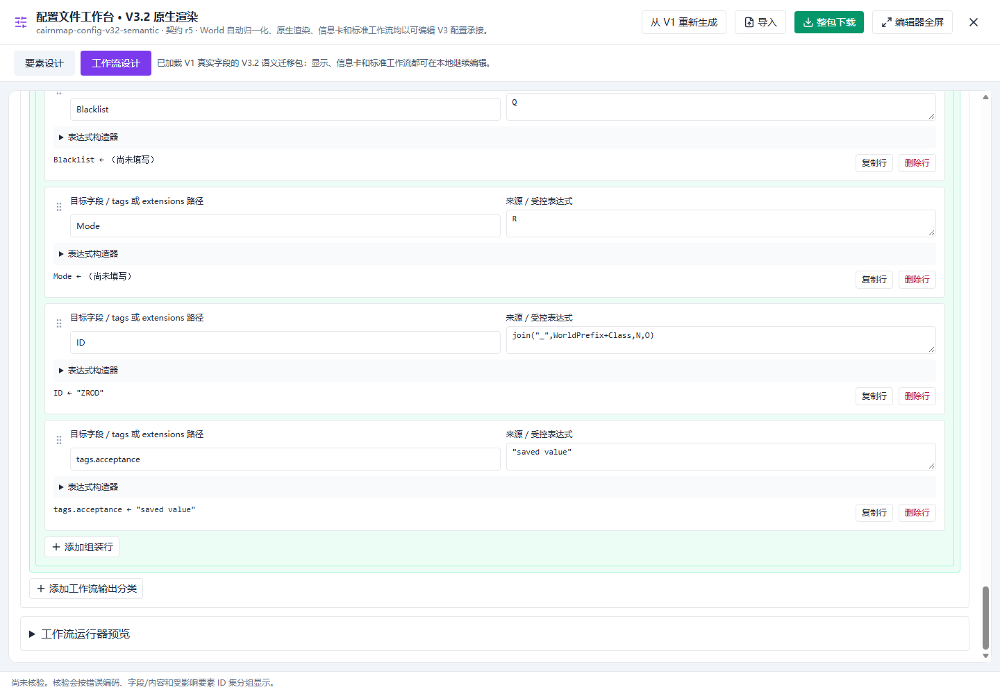
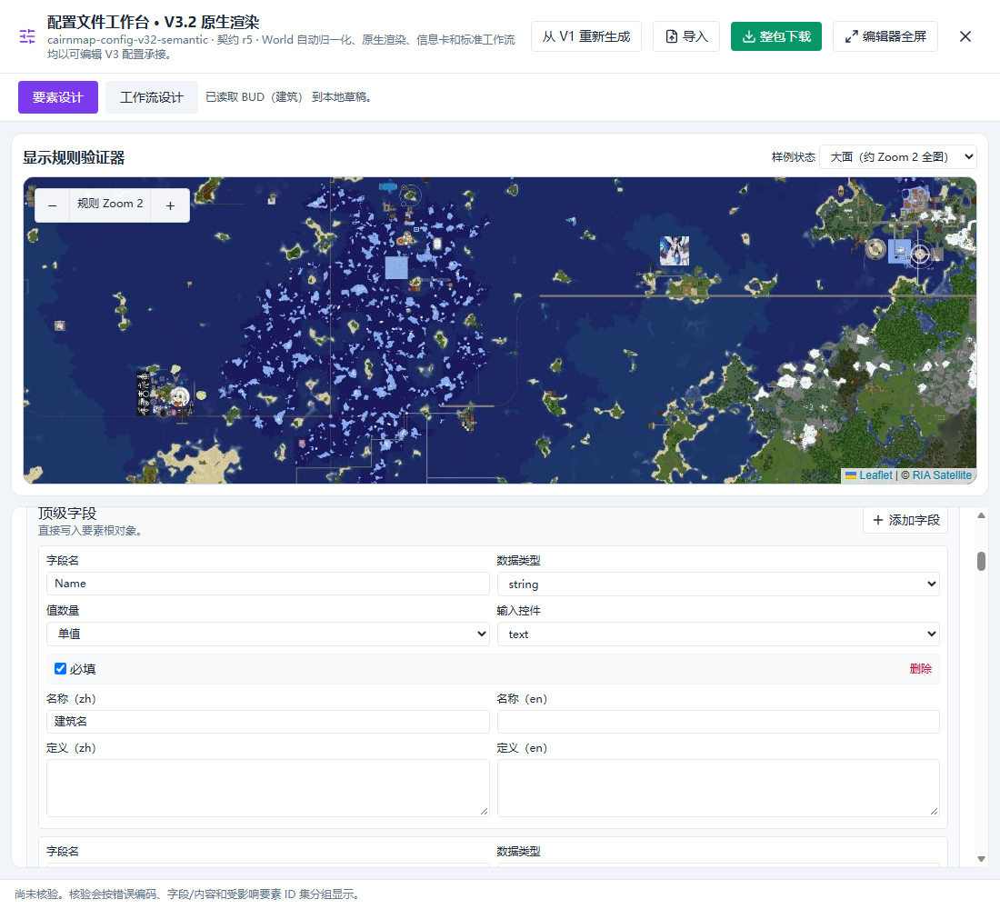
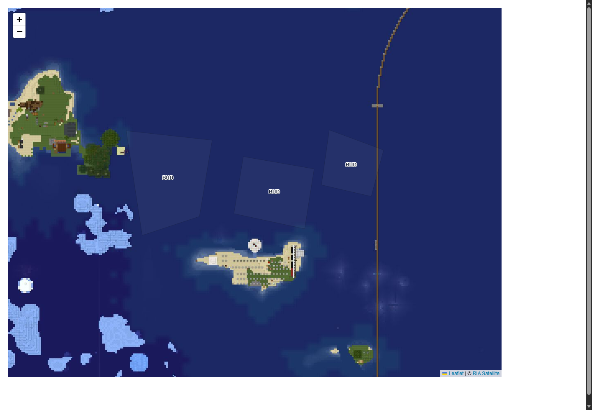
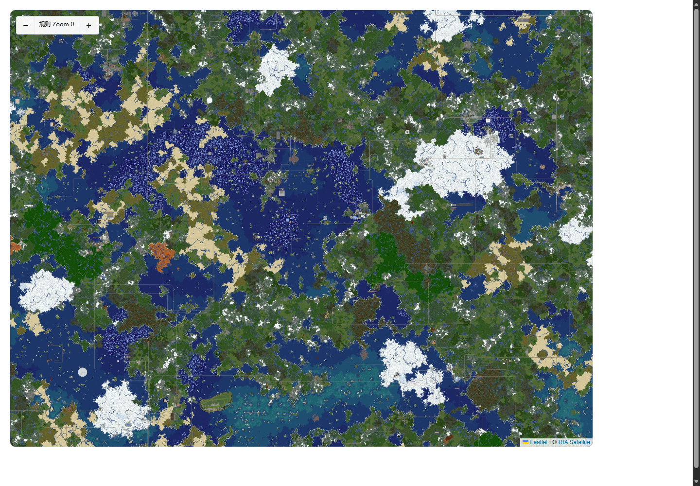

# Runtime V3.2 本地迁移修复交付记录

本轮已按交接及确认蓝图完成 Config Studio、工作流输出组装、显示与预览、多部件和字段语言修复。用户最新指令为“仅本地更新，暂不推送”：所有提交保留在 `codex/cm-config-runtime-v32-migration-20261007`，本轮未推送、未创建 PR、未更新 main 或 RIA 下游。

工作树：`G:/RIAWebGIS/NewPRES/CairnMap_Codex/wt/cairnmap-config-runtime-v32-migration-20261007`。迁移前冻结提交：`0b82863d4fea3791f98917ba6d13f70e1f27eb15`。功能修复至 `e143144`，浏览器验收工具提交为 `def8a34`；本记录与证据由随后单独提交保存。

## 实现与可回退提交

| 提交 | 结果 |
| --- | --- |
| `269ce83` | 最小 Node 20 CI：该迁移分支及后续 main PR 执行 verify/build，仅在本地保存 |
| `a65b11d` | 恢复要素设计／工作流设计双标签；共享已保存包；任一草稿保存或放弃前阻断切换；兼容入口回到同一 Studio；限制高度及滚轮 |
| `00fa44b` | 恢复每个 output 的 assignment 编辑、路径、受控 token／字面量／join、预览和手柄排序；统一安全表达式解析，禁止 eval |
| `836ffc6` | 17 类标准 composed 工作流、34 条完整 V1/V3 record fixtures；恢复保存值规范化与真实几何预览 |
| `45689f6` | 共享 Label 的九方向、正负 X/Y、候选与包围盒算法，center 保留 center |
| `a52d2c3` | 主图／验证器共享逻辑 Zoom 0–8、Leaflet -3–5、瓦片原生 -2–3；预览显示瓦片错误 |
| `2b952e9` | feature → 多 Label 缓存；每个部件拥有独立几何锚点、候选、碰撞和点击身份 |
| `8373623` | 英文空值不回退中文；导入旧 r5 中文残留清理；字段操作独立一行，保留 tags/extensions 容器 |
| `1a86983` | 补齐无效槽位、选项、搜索、重复组与输入值校验；接通运行器的实时组装预览；取消拖动清理状态 |
| `8ebfe98` | 所有 Label 家族应用 X 偏移与明确 CSS 原点；同 URL 图标尺寸／锚点变化刷新缓存 |
| `b58925c` | 每个部件单独执行屏幕阈值及动态权重；几何过滤保留原始要素身份；独立缓存键 |
| `e949fab` | 修复 ZIP 导出中的 undefined 非 JSON 内容；真实 ZIP/JSON 往返及防篡改校验 |
| `10efac3` | 低 Zoom 点与 Label 共享锚点；全部部件符号参与碰撞；明确来源为空时的行为 |
| `91a36c6` | 从未改动原 V1 格式器冻结铁路／车站／TRP 七条最终输出并进行专门对照 |
| `289202c` | 显式候选传入布局；原生固定方向先在自身锚点放置；保留各部件权重 |
| `540b347` | 修复自定义 Leaflet pane 中图片被全局 max-width 压为零的问题 |
| `e143144` | 对碰撞桥接保留部件权重建立回归检查 |
| `def8a34` | 保存可复跑浏览器脚本和独立渲染验收入口 |

每个功能主题均执行 `npm run verify:config-v32` 和 `npm run build`。过程中发现并修正的类型错误、序列化错误和实际浏览器问题，均在最终检查通过后收敛到上述提交。未改动 V1 `featureRenderRules` 规则基线；未使用 reset --hard、强推或旧 V3.1 页面替换。

恢复历史状态可对指定 SHA 创建额外 worktree；需要撤销已集成修复时使用 `git revert <SHA>` 保留历史。主题之间存在依赖，撤销多项时从最新提交向前处理并重新执行 verify/build。冻结 SHA 表示迁移开始时实际复制的脏工作树快照，不表示已经精确回退到无法证明的 12:04 状态。

## 自动化与浏览器验收

最终 [校验与构建结果](runtime-v32-acceptance-20261007/checks-result.json) 的两个命令均为 exit code 0。构建仅保留既有 toriiTeleport 动静态导入和大 chunk 提示。

| 验收 | 已通过证据 |
| --- | --- |
| V1 显示规则与迁移 | 19 个冻结显示探针；95 节点、20 工作流语义检查 |
| 工作流最终输出 | 34 条 composed 完整 record；7 条 external 保留格式器最终 record；JSON 重新导入后结果一致 |
| 保存阻断 | 无效分类、几何、目标、未知 token、重复／空 slot、选项、搜索、重复组均不能通过校验；真实 UI 的非法 target/token 保存保留草稿并显示错误 |
| 组装编辑 | 添加、复制、删除、受控表达式预览、手柄排序、实际文件导出—导入—保存；select 显示值／保存值分离，搜索多字段／模板／单返回值，对象及纯值数组 |
| 草稿与滚动 | 两侧草稿阻断切标签；保存／放弃后释放；兼容 URL 使用同一 Studio；受限容器接受真实滚轮事件 |
| 方向及偏移 | 九方向 × 五组正负 X/Y 的 45 次真实 DOM 像素测量；七类 Label 样式；测量误差小于 1px |
| 多部件 | 多点 3、多线 2、多面 3 个独立 Label；切到整体中心后各为 1；三个部件 Label 的实际鼠标点击均打开原始要素 JSON |
| 图片及点击 | 同 URL 尺寸、iconAnchor 更新跟随实际像素；图片矩形边缘和正 X／负 Y 偏移后的 Label 均可实际点击 |
| BUD 与同规则输出 | 在 V1、V3 主图、验证器分别记录逻辑 Zoom 0/2/3/5/6/8；V3 主图和验证器图层、尺寸、相对位置一致 |
| 低 Zoom | 0/1/2 分别加载 320/80/80 张真实瓦片，瓦片错误 0；等待加载结束后截取图片 |
| 字段／语言 | 1440 和 1100 宽度下无横向溢出；操作独立一行；英文空值保持空；tags/extensions 容器保留 |
| 结构预览 | 主结构只预览自身；单元包含尺寸更大的外部主结构；每个低 Zoom 部件点与 Label 的最终屏幕锚点一致 |

证据：[Studio 生命周期](runtime-v32-acceptance-20261007/studio-browser-result.json)、[组装及字段 UI](runtime-v32-acceptance-20261007/studio-extended-result.json)、[渲染及主图／预览对照](runtime-v32-acceptance-20261007/render-browser-result.json)、[真实点击](runtime-v32-acceptance-20261007/interaction-browser-result.json)。浏览器脚本未记录未捕获运行时异常。

人工视觉复核已查看组装面板、字段编辑器、多部件及真实低 Zoom 截图。部分代表图片附于本目录：

## 对照口径与复跑

`workflowOutputAssembler.ts` 的现有 V1 实现只提供映射统计和输出路径审计，并不组装最终 record。标准工作流的独立 oracle 因而使用真实 V1 workflow schema、路径组装和生产 `getFormatDef().buildFeatureInfo`，未借用 V3 assignments 或表达式 evaluator。V1 数字 World 转成 V3 canonical world ID 是明确允许的迁移；其他最终字段及几何完整比较。external 七条 fixture 由未改动原工作树的生产格式器生成，保留原数值 World 语义，比较当前保留执行路径的完整输出；这不表示铁路、车站、TRP 已改成 composed。

BUD 0–2 按规则隐藏，3–5 使用真实半径 6 的 V3 点，6–8 使用面。V1 在低档依赖标签装饰圆点；本轮按蓝图改为实际几何符号，因此不宣称 V1/V3 低档截图像素完全相同。已比较可见档位、锚点及 V3 主图／验证器一致性。

复跑核心：`npm run verify:config-v32`、`npm run build`。浏览器复跑说明见 [验收工具 README](../../scripts/config-tools/browser/README.md)，使用独立测试 profile 和顺序运行的 CDP 脚本。排序使用 HTML drag 事件验证手柄事件链，并检查其他控件不 draggable；点击和滚轮使用实际 CDP 鼠标事件。截图已由本轮进行视觉检查，用户操作验收仍可在当前本地版本继续进行。

## 基线保护与交付边界

[原工作树最终复核](runtime-v32-acceptance-20261007/source-final-verification.json) 确认：737 个项目文件、10603 个依赖文件、71 份冻结证据 SHA256 均未变化；原 HEAD 仍为 `5447e117a86d01f833bea012c1e0c09440489ff6`，原 status 保持不变。证据及日志原件位于工作区 `migration-runs/runtime-v32-20261007`；迁移前 `migration-baselines` 未覆写。

本地版本可评审、可回退。远端分支和 CI 尚未执行，后续发布 main、创建 PR 或同步 RIA 需要依据用户届时的明确指令。本轮不将本地通过表述为远端 CI 或生产发布已通过。
